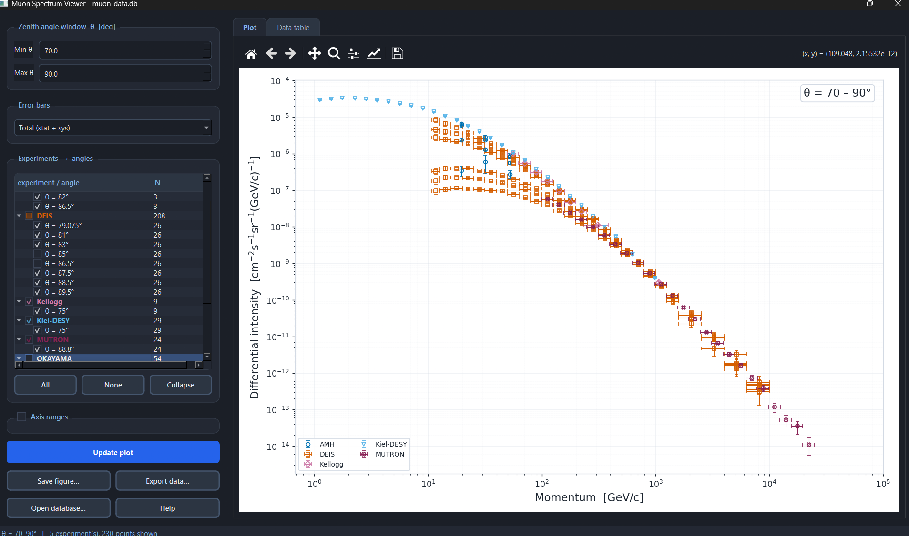

# Atmospheric Muon Differential Spectra Database

An open, source-verified database of atmospheric muon differential momentum
spectra compiled from nine historical cosmic-ray experiments, together with
the pipeline that builds it and a desktop app for exploring it.

Companion code for the paper *An open database of the energy and angular distribution of atmospheric muons, with emphasis on large zenith angles*, submitted to *Astroparticle Physics*.

## Licence
- Code (`*.py`): MIT, see `LICENSE`
- Data (`muon_data.*`): CC BY 4.0, see `LICENSE-CC-BY`
  
## Experiments included

| Experiment | Rows | Reference |
|---|---|---|
| DEIS | 208 | Allkofer, O.C., Bella, G., Dau, W.D., Jokisch, H., Klemke, G., Oren, Y., Uhr, R., "Cosmic ray muon spectra at sea-level up to 10 TeV," *Nucl. Phys. B* 259 (1985) 1–18 |
| AMH | 21 | Green, P. J., Duller, N. M., Magnuson, C. E., Choate, L. M., Sheldon, W. R., Osborne, A. R., Benbrook, J. R., Abdel-Monem, M. S., "Absolute intensities of medium-energy muons in the vertical and at zenith angles 55°–85°," *Phys. Rev. D* 20 (1979) 1598–1607 |
| OKAYAMA | 210 | Tsuji, S., Katayama, T., Okei, K., Wada, T., Yamamoto, I., Yamashita, Y., "Measurements of muons at sea level," *J. Phys. G: Nucl. Part. Phys.* 24 (1998) 1805–1822 |
| Kiel-DESY | 29 | Jokisch, H., Carstensen, K., Dau, W. D., Meyer, H. J., Allkofer, O. C., "Cosmic-ray muon spectrum up to 1 TeV at 75° zenith angle," *Phys. Rev. D* 19 (1979) 1368–1372 |
| MUTRON | 24 | Matsuno, S., et al., "Cosmic-ray muon spectrum up to 20 TeV at 89° zenith angle," *Phys. Rev. D* 29, No. 1 (1984) 1–11 |
| L3+C | 98 | Achard, P., et al. [L3 Collaboration], "Measurement of the Atmospheric Muon Spectrum from 20 to 3000 GeV," *Physics Letters B* 598 (2004) 15–32 (arXiv:hep-ex/0408114) |
| De Pascale | 21 | De Pascale, M. P., Morselli, A., Picozza, P., Golden, R. L., Grimani, C., Kimbell, B. L., Stephens, S. A., Stochaj, S. J., Webber, W. R., et al., "Absolute Spectrum and Charge Ratio of Cosmic Ray Muons in the Energy Region From 0.2 GeV to 100 GeV at 600 m Above Sea Level," *J. Geophys. Res.* 98(A3) (1993) 3501–3508 |
| Kellogg | 18 | Kellogg, R. G., Kasha, H., Larsen, R. C., "Momentum spectra, charge ratio, and zenith-angle dependence of cosmic-ray muons," *Phys. Rev. D* 17 (1978) 98–113 |
| Nottingham | 52 | Judge, R. J. R., Nash, W. F., "Measurements on the Muon Flux at Various Zenith Angles," *Il Nuovo Cimento* 35 (1965) 999–1024 |

**Total: 681 rows** across all nine experiments.

## Repository layout

```
.
├── raw_deis.py                  # per-experiment transcription + transform()
├── raw_amh.py
├── raw_okayama.py
├── raw_kieldesy.py
├── raw_mutron.py
├── raw_l3c.py
├── raw_depascale.py
├── raw_kellogg.py
├── raw_nottingham.py
├── build_database.py            # runs all nine transform()s, writes the databases
├── muon_spectrum_visualization.py   # PyQt6 desktop viewer
├── overlap_analysis.py          # cross-dataset chi2/ratio comparisons
├── coverage_plot.py             # angle-vs-momentum coverage scatter plot
└── README.md
```

### `raw_<experiment>.py`

One module per experiment. Each contains:

- **`RAW_TABLE*`** — the data exactly as printed in the source paper's
  table(s), in the paper's own units, with no conversion or combination.
  Every value is annotated with its source table and page number.
- **`transform()`** — converts the raw table into the database's common
  schema: momentum in GeV/c, intensity in cm⁻² s⁻¹ sr⁻¹ (GeV/c)⁻¹, with
  statistical and systematic uncertainties kept separate.


### `build_database.py`

Calls each experiment module's `transform()`, collects the rows, and writes
out two SQLite databases plus CSV exports (standard-library only -
`sqlite3` and `csv`):

- **`muon_data.db` / `muon_data.csv`** - the processed database: one row per
  (experiment, angle, momentum) measurement, in common units, with a
  `total_error = sqrt(stat_error² + sys_error²)` column computed centrally.
  A `data_dictionary` table describing every column is embedded in the
  `.db` file itself. A `UNIQUE` constraint prevents duplicate rows.
- **`muon_data_raw.db` / `muon_data_raw.csv`** - a literal dump of every
  `RAW_*` table, before any unit conversion, for checking the pipeline
  against the original papers.
- **`sources.csv`** - one row per experiment with its reference, row count,
  and a short description.

```bash
python build_database.py
```

Safe to re-run - existing databases are deleted and rebuilt from scratch
each time.

### `muon_spectrum_visualization.py`

A PyQt6 desktop visualization tool for browsing the database interactively: a hierarchical
experiment -> angle tree for selecting which spectra to plot, a log-log
matplotlib canvas, and a choice of statistical / systematic / total error
bars.

```bash
pip install PyQt6 matplotlib numpy
python muon_spectrum_visualization.py
```



#### Pre-built Windows executable

MuonSpectrumViewer.exe is a convenience build of muon_spectrum_visualization.py for users without a Python installation. It is not needed to use the database. It reads muon_data.db, which must be in the same folder. The executable is available from the software record on Zenodo [doi:10.5281/zenodo.23776980](https://doi.org/10.5281/zenodo.23776980). The Python source in this repository is the reference implementation.


### `overlap_analysis.py`

For every pair of experiments that overlap in both zenith angle and
momentum, this script auto-detects the best-matched overlap region,
interpolates in log-log space, and reports a χ²/ndf and intensity ratio -
a quantitative check of agreement or discrepancy between independent
measurements.

```bash
python overlap_analysis.py
```

Writes `overlap_ratios.png` / `.svg` (ratio plots with 1σ bands) and
`overlap_summary.csv` (χ²/ndf and mean ratio per comparison pair).

### `coverage_plot.py`

Produces a scatter plot of zenith angle vs. momentum for every measurement
in the database, showing which (angle, momentum) regions each experiment
covers.

```bash
python coverage_plot.py
```

## Requirements

- Python 3.9+
- Standard library only for `build_database.py`
- `numpy`, `matplotlib` for analysis and plotting scripts
- `PyQt6` additionally for `muon_spectrum_visualization.py`
- `pandas` for `coverage_plot.py`

```bash
pip install numpy matplotlib pandas PyQt6
```

## Quick start

```bash
python build_database.py                 # builds muon_data.db
python muon_spectrum_visualization.py     # explore it interactively
python overlap_analysis.py                # cross-dataset consistency checks
python coverage_plot.py                   # angle/momentum coverage map
```

## Citation

If you use this database, please cite:

> Khirstina Kotseva, Sergey Gorbunov, "An open database of the energy and angular distribution of atmospheric muons, with emphasis on large zenith angles", *Astroparticle Physics* (in review)

> Kotseva, K., & Gorbunov, S. (2026). Atmospheric Muon Differential Spectra Database Viewer [Computer software]. Zenodo. https://doi.org/10.5281/zenodo.23776980

> Kotseva, K., & Gorbunov, S. (2026). Atmospheric Muon Differential Spectra Database [Dataset]. Zenodo. https://doi.org/10.5281/zenodo.23777258

